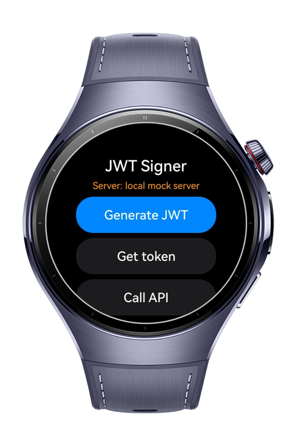
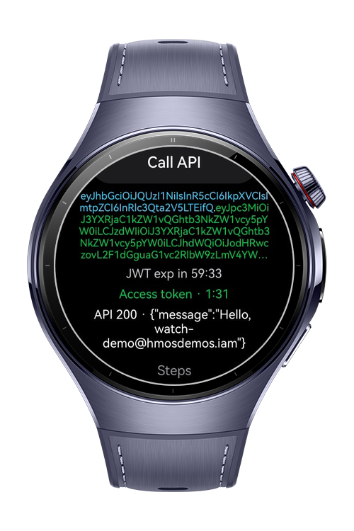

> **Note:** To access all shared projects, get information about environment setup, and view other guides, please visit [Explore-In-HMOS Index](https://github.com/Explore-In-HMOS/hmos-index).

# How to Build JWT with Crypto Kit

This HarmonyOS wearable sample shows how to build and sign a JSON Web Token (JWT) on a smart watch with Crypto Architecture Kit. The app loads an RSA private key from a PEM file, signs the token with SHA256withRSA/PSS (PS256) and a 32-byte salt, and gets an access token for a service account. Then it uses the access token to call a protected API.

> **WARNING:** The key in `rawfile/keys` is a test key. Do not put a real private key in an app package. In a real app, generate the key on the device with HUKS, or let a server sign the JWT.

# Preview

<div>
  
  
</div>

# Use Cases

- Encode the JWT header and payload with Base64URL and no padding
- Load an RSA private key from a PKCS#8 or PKCS#1 PEM file with `convertPemKey`
- Sign data with `RSA2048|PSS|SHA256|MGF1_SHA256` and a salt length of 32 bytes
- Verify the signature with the public key before the app sends the JWT
- Combine the header, the payload, and the signature into a complete JWT
- Exchange the JWT for an access token (JWT bearer grant, RFC 7523) and call a protected API
- Refresh the access token automatically when it expires

# Technology

## Stack

- **Languages**: ArkTS, ArkUI
- **Frameworks**: HarmonyOS Stage Model
- **Tools**: DevEco Studio, Hvigor, Hypium, Node.js (reference server)
- **Libraries**:
	- `@kit.CryptoArchitectureKit` (`cryptoFramework`)
	- `@kit.NetworkKit` (`http`)
	- `@kit.ArkTS` (`util`)
	- `@kit.AbilityKit` (`UIAbility`)
	- `@ohos/hypium` (unit tests)

## Required Permissions

- ohos.permission.INTERNET

## Flow

The app shows each step with its status and duration:

| Step | Function | Code |
|---|---|---|
| Load key | Reads the PEM files and converts them to a key pair | `PemKeyLoader.load` |
| Build header + payload | Makes the header and the claims, and encodes them with Base64URL | `JwtBuilder` |
| Sign PS256 | Signs `header.payload` | `PssSigner.sign` |
| Self-verify | Verifies the signature with the public key | `PssSigner.verify` |
| Token request | Sends the JWT to the token endpoint | `AuthTransport.exchange` |
| API call | Calls the protected API with the access token | `AuthTransport.callApi` |

## JWT Content

Header:

```json
{ "alg": "PS256", "typ": "JWT", "kid": "<keyId>" }
```

Payload:

```json
{ "iss": "<issuer>", "sub": "<subject>", "aud": "<audience>", "iat": 1761050000, "exp": 1761053600, "jti": "<UUID>" }
```

The token is `base64url(header) + "." + base64url(payload) + "." + base64url(signature)`. The screen shows the three parts in blue, green, and orange.

## Signing

```typescript
const signer = cryptoFramework.createSign('RSA2048|PSS|SHA256|MGF1_SHA256');
await signer.init(privateKey);
signer.setSignSpec(cryptoFramework.SignSpecItem.PSS_SALT_LEN_NUM, 32);
const signature = await signer.sign({ data: signingInput });
```

Set the salt length after `init` and before `sign`. A server that expects PS256 rejects a signature with a different salt length.

## Buttons

| Button | Function |
|---|---|
| Generate JWT | Runs the first four steps |
| Get token | Makes a new JWT if necessary, then gets an access token |
| Call API | Gets an access token if necessary, then calls the API. If the API returns 401, the app gets a new token one time and tries again. |

The app uses a JWT and an access token again until 30 seconds before they expire.

## Server Modes

| Mode | When | Function |
|---|---|---|
| Local mock server | `tokenUrl` and `apiUrl` in `config.json` are empty | An in-app server verifies the signature with its own copy of the public key. It checks `aud`, `exp`, and `iat`, and gives a 120-second access token. |
| HTTP server | `tokenUrl` and `apiUrl` are set | The app sends the requests to the server. You can use the reference server in `tools/verify-server`. |

When both URLs are set, the **Local mock server** switch selects the mode.

## Use the Reference Server

1. Open a terminal in `tools/verify-server`.
2. Run `node server.js`. The server shows its `tokenUrl` and `apiUrl`.
3. Copy the two URLs into `entry/src/main/resources/rawfile/config.json`.
4. Make sure that the watch and the computer are on the same network.
5. Build and run the app.
6. Set **Local mock server** to off.
7. Tap **Call API**.

The server checks the PS256 signature with a salt length of 32, the audience, the expiry, and `iat`. It rejects a JWT that has a different salt length, a changed signature, or an `iat` in the future.

> **NOTE:** If `audience` in `config.json` changes, start the server with the same value: `AUDIENCE=<value> node server.js`.

## Clock Check

After a token request, the app compares the watch clock with the `Date` header of the server. If the difference is more than 60 seconds, the event log shows a warning. A watch clock that is fast makes `iat` a time in the future, and the server rejects the JWT.

## Configuration

`entry/src/main/resources/rawfile/config.json`:

| Key | Description |
|---|---|
| tokenUrl | Token endpoint. Empty: local mock server |
| apiUrl | Protected API. Empty: local mock server |
| issuer, subject | `iss` and `sub` claims |
| audience | `aud` claim. It must match the server. |
| keyId | `kid` header |
| lifetimeSeconds | JWT lifetime. `exp = iat + lifetimeSeconds` |

## Change the Key

1. Make a 2048-bit RSA key pair. For example:
   ```bash
   openssl genpkey -algorithm RSA -pkeyopt rsa_keygen_bits:2048 -out service_account.pem
   openssl pkey -in service_account.pem -pubout -out service_account.pub.pem
   ```
2. Put both files in `entry/src/main/resources/rawfile/keys`.
3. Copy `service_account.pub.pem` to `tools/verify-server/public.pem`.

The app accepts PKCS#8 (`BEGIN PRIVATE KEY`) and PKCS#1 (`BEGIN RSA PRIVATE KEY`) keys. It does not accept encrypted keys. The app never writes the private key to the log.

## Unit Tests

The `entry/src/test` folder has 16 local unit tests for `Base64Url`, `JwtBuilder`, and `PemKeyLoader`.

To run the tests from the command line, use this command in the project folder:

```bash
hvigorw --mode module -p module=entry@default -p product=default -p buildMode=test test
```

> **NOTE:** `Base64Url` uses plain ArkTS code and not `util.Base64Helper`. In local unit tests, the native `util` functions do not return real values. With plain ArkTS code, the same code runs on the watch and in the tests.

# Directory Structure

```
entry/
|   src/
|       main/
│   module.json5
│
├───ets
│   ├───auth
│   │       AuthConfig.ets
│   │       AuthTransport.ets
│   │       HttpAuthTransport.ets
│   │       MockAuthTransport.ets
│   │       ServiceAccountAuth.ets
│   │
│   ├───common
│   │       Constants.ets
│   │       Logger.ets
│   │
│   ├───entryability
│   │       EntryAbility.ets
│   │
│   ├───jwt
│   │       Base64Url.ets
│   │       JwtBuilder.ets
│   │       PemKeyLoader.ets
│   │       PssSigner.ets
│   │
│   └───pages
│           Index.ets
│
├───resources/rawfile
│   │   config.json
│   └───keys
│           service_account.pem
│           service_account.pub.pem
│
|       test/
│           Base64Url.test.ets
│           JwtBuilder.test.ets
│           List.test.ets

tools/
└───verify-server
        public.pem
        server.js

```

# Constraints and Restrictions

## Supported Device

- Huawei Watch 5

## Notes

- The sample uses a 2048-bit RSA key (`RSA2048`). For a different key size, change `KEY_ALGORITHM` and `SIGN_ALGORITHM` in `Constants.ets`.
- The reference server uses HTTP for a local test. Use HTTPS for a real server.

# License

**How to Build JWT with Crypto Kit** is distributed under the terms of the MIT License. See the [LICENSE](LICENSE) for more information.
